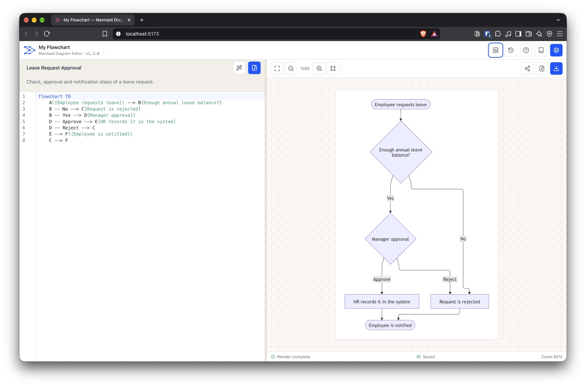
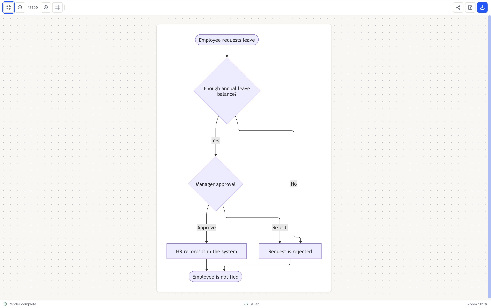
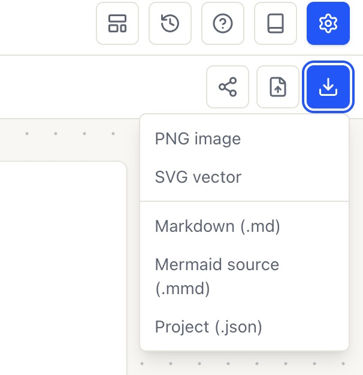

# My Flowchart

> A **serverless** Mermaid diagram editor that runs in your browser.
> Write, preview live, export. No data ever leaves your device.

[](https://github.com/ibrhalil/my-flowchart/actions/workflows/ci.yml)
[](LICENSE)

My Flowchart is a clean, fast interface for creating flowcharts, sequence diagrams and more with [Mermaid](https://mermaid.js.org/) syntax. Everything happens in the browser — no installation, account or backend required.

---

## Screenshots

<p align="center">
  
  <br>
  <em>Mermaid code on the left, live preview on the right</em>
</p>

<p align="center">
  
  <br>
  <em>Full-screen preview — zoom, pan and fit to screen</em>
</p>

<p align="center">
  
  <br>
  <em>Export in 5 formats: PNG, SVG, Markdown, <code>.mmd</code>, JSON</em>
</p>

---

## Features

**Writing and preview**

- **Live preview** — the diagram updates as you type; on a temporary syntax error the last valid diagram stays on screen
- **17+ diagram types** — flowchart, sequence, class, state, ER, gantt, pie, journey, git, mindmap, timeline, quadrant, requirement, architecture, xychart, block, kanban
- CodeMirror 6 based editor (folding, search, line numbers)
- **Syntax linter** — catches non-ASCII node IDs and unquoted labels, and fixes them with one click
- **Zoom / pan / full screen** and fit to screen (`Ctrl/⌘ + wheel` to zoom)

**Templates and new documents**

- **40 ready-made templates**, each with Turkish and English content; with search, a type filter and hints explaining **what each type is used for**
- **New diagram** — start from a template or a blank document; clicking the logo opens a blank diagram directly. Your unsaved work is moved to history first

**Export and import**

- **5 export formats** — PNG, SVG, Markdown, `.mmd`, JSON. PNG looks exactly like the preview (including margins and the theme background)
- **Import** — `.mmd`, `.json` and `.md` (frontmatter + code block). Leading `%%` comment lines in an `.mmd` file are read as the description; on export, the description is written back to the top of the file the same way

**Sharing**

- **Share link** — the Share button encodes the diagram (title, description, code) into a single link; no server needed. On desktop the link is copied to the clipboard, on mobile the system share sheet opens. Whoever opens the link gets the diagram loaded automatically; their own work is saved to history first

**Saving and history**

- **Automatic draft saving** + **history snapshots** (up to 50 entries, kept in browser storage). Click anywhere on a row to restore it
- **Multi-tab safety** — if two tabs edit the same document, one never overwrites the other's work; the version about to be overwritten is saved to history. History and settings are synced live between tabs

**Interface**

- **Light theme is the default**, dark theme is optional; the interface language is detected from the browser language (TR / EN) and can be changed in Settings
- **About** — app version, commit, build date and versions of key dependencies (from the version button in the header or from Settings)

---

## Data and Privacy

Diagrams are kept **only in the browser's `localStorage`** and are never sent to any server. The app uses these keys:

| Key                           | Content                                              |
| ----------------------------- | ---------------------------------------------------- |
| `mermaid-studio:draft:v1`     | The working document (title, description, code)      |
| `mermaid-studio:history:v1`   | History snapshots                                    |
| `my-flowchart-settings`       | Theme, font size, PNG resolution, auto-save          |
| `my-flowchart-locale`         | Selected interface language                          |

To delete everything, use **Settings → Data → Delete all data** (asks for two-step confirmation and cannot be undone). Only this app's keys are deleted; other data on the same origin is left untouched. You can export your document before deleting.

**Share links:** the content travels in the `#` part of the address; browsers do not send that part to the server, so servers and access logs never see the diagram. A link is a **copy** of the diagram at that moment (it never changes afterwards and cannot be revoked), and anyone with the link can read the content; keep this in mind when sharing diagrams that contain confidential information. The link is generated from the address the app is served at; even if the domain or subdomain changes, the same link format opens everywhere.

> No internet connection is needed while the page is open; one is needed to reload the page (there is no service worker).

---

## Quick Start (Development)

Requirements: [Node.js](https://nodejs.org/) 20.19+ (or 22.12+) and npm. CI and the Docker image build with Node 24.

```bash
# Install dependencies
npm install

# Start the development server (http://localhost:5173)
npm run dev
```

### Available commands

| Command           | Description                                    |
| ----------------- | ---------------------------------------------- |
| `npm run dev`     | Vite development server (HMR)                  |
| `npm run build`   | Type check + production build → `dist/`        |
| `npm run preview` | Preview the production build locally           |
| `npm run lint`    | Lint the code with [oxlint](https://oxc.rs/)   |

---

## Running with Docker

The project is a fully static SPA. You can bring it up with a single command:

```bash
# Build the image
docker build -t my-flowchart .

# Run on the default port (8765)
docker run -e PORT=8765 -p 8765:8765 my-flowchart
```

Open **http://localhost:8765** in your browser. That's it.

### With Docker Compose

You can run the same setup with `compose.yaml` (restart policy included):

```bash
# Build and start in the background (http://localhost:8765)
docker compose up -d --build

# With a different port and commit info
PORT=9090 GIT_COMMIT=$(git rev-parse --short HEAD) docker compose up -d --build

# Stop and remove
docker compose down
```

`PORT` sets both the port the container listens on and the port published on the host (default `8765`). If `GIT_COMMIT` is not given, the commit is not shown in the About modal.

### Adding commit info to the image

Since the `.git` folder is not copied into the image, the commit number in the About modal is empty by default. To show it, pass a build argument:

```bash
docker build --build-arg GIT_COMMIT=$(git rev-parse --short HEAD) -t my-flowchart .
```

### Changing the port (multiple apps)

The service port is set at runtime with the `PORT` environment variable (default `8765`; it avoids common ports like `8080`/`3000`). If you run several UI apps on the same server, give each instance a different port:

```bash
# Run a second instance on port 9090
docker run -e PORT=9090 -p 9090:9090 my-flowchart
```

> `-e PORT=<port>` sets the port the container listens on, and `-p <port>:<port>` sets the port published on the host. Both must be the same.

> The image uses a multi-stage build: it is built with `node:24-alpine` and then served on `nginx:stable-alpine` (~71 MB in total). It includes SPA routing, gzip compression, long-term caching for hashed files, a configurable port and a health check.

---

## Production Deployment

After `npm run build`, the `dist/` folder can be put on any static server:

- **Static hosts:** GitHub Pages, Netlify, Vercel, Cloudflare Pages
- **Cloudflare (Workers static assets):** `wrangler.jsonc` is ready; it serves the `dist/` folder with SPA routing
- **Your own server:** `nginx` (see `nginx.conf.template` for an example configuration) or `caddy`
- **Docker:** the method above

> Note: The app is configured to be served from the root path. To deploy under a subpath, change the `base` setting in `vite.config.ts`.

---

## Project Structure

```
src/
├── components/     # UI components (Editor, Preview, Gallery, History, Layout, Settings, ui)
├── data/           # Templates (TR/EN sources) and TR/EN translation dictionaries
├── hooks/          # Reusable React hooks (auto-save, cross-tab sync, etc.)
├── lib/            # i18n (React context + runtime mirror), build-time version info
├── services/       # Mermaid rendering, export/import, storage, conversion
├── store/          # Zustand stores (diagram + settings)
└── types/          # Shared TypeScript types
```

### Architecture notes

- **State management:** Two Zustand stores — `diagramStore` (document content, history) and `settingsStore` (theme, font size, export and auto-save settings; persisted). The draft is written with a short delay after keystrokes; a pending save is written immediately when the page closes.
- **i18n:** Two layers — React components use the `useTranslation()` hook, while non-React code (the stores) uses the `rt()` runtime translation. Template titles, descriptions and diagram sources are kept in both languages.
- **Multi-tab:** A draft written by another tab is saved to history before it would be overwritten; history and settings are synced through the `storage` event. When "Delete all data" runs, pending writes are blocked and other tabs are reloaded.
- **PNG safety:** Mermaid is configured with `htmlLabels: false` (it must be set at the root level for the ELK layout); labels become `<text>` instead of `<foreignObject>`, so the SVG does not taint the canvas when drawn and `toBlob()` works safely. The only exception is mindmap: it is drawn with HTML labels, and `<foreignObject>` elements are converted to `<text>` when exporting to PNG.
- **Share format:** `#s=1.<data>`. The data is the JSON `{t: title, d: description, c: code}` compressed with the browser's built-in `CompressionStream('deflate-raw')` and encoded as base64url (`1` = compressed, `0` = uncompressed fallback; an unknown version is treated as "unsupported"). When opening, the decompressed size is capped at 256 KB (protection against decompression bombs), the fields are validated, and rendering already runs with `securityLevel: 'strict'`. The link is precomputed in the background because Safari rejects share/copy calls made after an `await`. If the link exceeds 8,000 characters, the user is warned.
- **Version info:** At build time, `vite.config.ts` reads the version from `package.json`, the **installed** dependency versions from `node_modules` and the commit from git, and embeds them into the app via `define`. Which dependencies are shown in the About modal is kept in the `SHOWN_DEPENDENCIES` list.

---

## Contributing

Contributions are welcome! A simple flow:

1. Fork the repo
2. Create a feature branch (`git checkout -b feature/awesome-thing`)
3. Commit your changes (make sure `npm run lint` and `npm run build` pass)
4. Open a Pull Request

Please run `npm run lint && npm run build` before committing to verify that the code is clean and builds.

---

## License

[MIT](LICENSE) © Halil AYDIN

This project uses [Mermaid](https://mermaid.js.org/), [React](https://react.dev/), [Vite](https://vite.dev/), [CodeMirror](https://codemirror.net/) and [Tailwind CSS](https://tailwindcss.com/).
